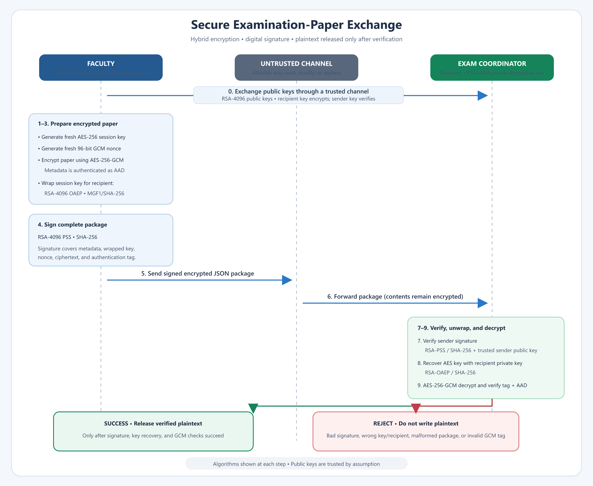

# Secure Examination-Paper Exchange

## Assignment information

| Field | Details |
|---|---|
| Course | Cryptography |
| Assignment | Secure Examination-Paper Exchange Using Python |
| Student name(s) | Saksham Kushwah |
| Roll number(s) | 24BDS072 |


## 1. Problem statement

An examination paper must be sent by a faculty member (the **sender**) to an authorised examination coordinator (the **recipient**) over a communication channel that may be monitored or modified by an attacker. The application must keep the paper confidential, detect changes, verify the sender, and refuse to release plaintext unless verification and decryption both succeed.

This project simulates the sender and recipient using separate folders on one computer. Their public keys are exchanged through a trusted channel, as assumed in the assignment.

## 2. Objectives

- Generate separate RSA key pairs for the sender and recipient and store private keys as passphrase-encrypted PKCS#8 PEM files.
- Encrypt each paper with a fresh AES session key using AES-GCM and a fresh nonce.
- Protect the session key for the recipient using RSA-OAEP.
- Sign the complete encrypted package using RSA-PSS.
- Verify the signature before decrypting; write recovered plaintext only after all checks succeed.
- Test authorised delivery, tampering, incorrect keys, and repeated encryption.

## 3. Algorithms and parameters

| Operation | Algorithm and parameters |
|---|---|
| Sender and recipient key pairs | RSA-4096, public exponent 65537 |
| Private-key storage | Passphrase-encrypted PKCS#8 PEM |
| Examination-paper encryption | AES-256-GCM, fresh 256-bit session key, fresh 96-bit nonce, 128-bit tag |
| Session-key protection | RSA-OAEP with MGF1-SHA-256 and SHA-256, recipient public key |
| Digital signature | RSA-PSS with MGF1-SHA-256 and SHA-256, sender private key |
| Package encoding | JSON; canonical sorted-key JSON is signed |

The package metadata is also supplied to AES-GCM as associated authenticated data (AAD). It is authenticated but is not encrypted.

## 4. How the application works

### Sender

1. Read the examination paper and create a fresh AES-256 session key and 96-bit nonce.
2. Encrypt the paper with AES-256-GCM, binding the metadata as AAD.
3. Encrypt (wrap) the AES session key with the recipient's RSA public key using OAEP/SHA-256.
4. Build a package containing the metadata, wrapped key, nonce, ciphertext, and tag.
5. Sign the canonical encoding of the complete package using the sender's RSA private key and PSS/SHA-256.
6. Send the JSON package over the untrusted channel.

### Recipient

1. Parse and validate the package structure and expected recipient identity.
2. Verify the signature against the trusted copy of the sender's public key.
3. Unwrap the AES key using the recipient's RSA private key.
4. Decrypt with AES-GCM and verify the tag and metadata AAD.
5. Write plaintext only if every preceding check succeeds; otherwise reject the package.

The JSON package contains `metadata` (`version`, `package_id`, `filename`, `sender`, `recipient`, `created_utc`, and algorithms), `encrypted_session_key`, `nonce`, `ciphertext`, `tag`, and `signature`.


## 5. Sequence diagram

The diagram labels the algorithms and key sizes used at each stage of the exchange.



The high-resolution PNG is [`sequence-diagram.png`](./sequence-diagram.png); 

## 6. Confidentiality, integrity, and sender authentication

- **Confidentiality:** AES-GCM encrypts the examination paper. The AES key is randomly generated for each encryption and wrapped to the recipient's public key. An observer of the package does not receive the plaintext or the unwrapped AES key.
- **Integrity:** The sender's signature covers every package field other than the signature itself, including metadata, wrapped key, nonce, ciphertext, and tag. Any modification causes signature verification to fail. AES-GCM independently authenticates the ciphertext and metadata AAD during decryption.
- **Sender authentication:** Only the holder of the sender's private signing key can create a signature that verifies against the sender's trusted public key. A valid signature therefore establishes that the package was signed by the corresponding key; secure identity binding depends on the assumed trusted public-key exchange.

## 7. Project files and submitted outputs

| Path | Purpose |
|---|---|
| [`secure_exam.py`](./secure_exam.py) | Key generation, package creation, verification/decryption, and command-line interface |
| [`run_simulation.py`](./run_simulation.py) | Creates separate sender, recipient, channel, and attacker folders and runs the test scenarios |
| [`requirements.txt`](./requirements.txt) | Python dependency declaration (`cryptography`) |
| [`test_results.txt`](./test_results.txt) | Captured terminal output showing all 18 checks passing |
| [`samples/exam_paper.txt`](./samples/exam_paper.txt) | Sample examination paper |
| [`samples/exam_paper.pkg.json`](./samples/exam_paper.pkg.json) | Sample encrypted and signed package |
| [`samples/exam_paper_run_A.pkg.json`](./samples/exam_paper_run_A.pkg.json) and [`samples/exam_paper_run_B.pkg.json`](./samples/exam_paper_run_B.pkg.json) | Two packages showing that repeated encryption produces different output |
| [`samples/exam_paper_decrypted.txt`](./samples/exam_paper_decrypted.txt) | Sample recovered file for comparison with the input |
| [`samples/faculty_public.pem`](./samples/faculty_public.pem) | Public key corresponding to the sample package's sender signature |
| [`sequence-diagram.png`](./sequence-diagram.png) | High-resolution sequence diagram image |

The sample directory contains no private keys. The simulation creates passphrase-protected demo keys and other generated files locally under `simulation/`; that directory is excluded from Git. Run the simulation to generate a matching local sender/recipient key set and repeat the complete decryption tests.

## 8. Installation and execution

Use Python 3 and PowerShell from the project directory:

```powershell
python -m pip install -r requirements.txt
python run_simulation.py
```

Each run creates a new `simulation/run_<id>/` directory and does not overwrite previous runs. The test log is printed in the terminal and saved to `test_results.txt` and the run directory.

### Optional manual command-line exchange

Generate sender and recipient key pairs. The commands prompt for passphrases to encrypt the private-key files:

```powershell
python secure_exam.py keygen --name faculty --folder simulation/sender
python secure_exam.py keygen --name coordinator --folder simulation/recipient
```

Exchange `coordinator_public.pem` with the sender and `faculty_public.pem` with the recipient using a trusted channel. Then run the sender's encryption command and the recipient's decryption command:

```powershell
python secure_exam.py encrypt --in simulation/sender/exam_paper.txt --out simulation/channel/exam_paper.pkg.json --sender faculty --recipient coordinator --sender-key simulation/sender/faculty_private.pem --recipient-pub simulation/sender/coordinator_public.pem
python secure_exam.py decrypt --in simulation/channel/exam_paper.pkg.json --out simulation/recipient/exam_paper_decrypted.txt --sender-pub simulation/recipient/faculty_public.pem --recipient-key simulation/recipient/coordinator_private.pem --recipient coordinator
```

The simulation embeds demo passphrases for repeatable automated tests; do not use those demo keys or passphrases for real examination material. The CLI prompts interactively. `EXAM_KEY_PASSPHRASE` is available for automation but should not be used as a permanent or shared secret.

## 9. Testing and results

The latest recorded simulation completed **18/18 checks successfully**. Full terminal output is in [`test_results.txt`](./test_results.txt).

| Scenario | Expected result | Observed result |
|---|---|---|
| Authorised recipient uses the correct keys | Decrypt successfully; output matches input | Passed; SHA-256 hashes match |
| Ciphertext, metadata, signature, tag, nonce, or wrapped key is changed | Reject package | Passed |
| Required package field is missing | Reject malformed package | Passed |
| Attacker modifies and re-signs a package with their own key, or replaces it with a forged package | Reject untrusted signature | Passed |
| Signed package names a different recipient | Reject wrong recipient | Passed |
| Recipient uses an incorrect private key or key-file passphrase | Reject key recovery/loading | Passed |
| Recipient verifies with an incorrect sender public key | Reject signature | Passed |
| Same paper is encrypted twice | Packages differ; both valid packages decrypt correctly | Passed; session key, nonce, ciphertext, tag, signature, and package ID differ |

The command-line path was also checked: the authorised package decrypts with a matching file hash, while tampered and wrong-recipient packages are rejected without creating an output file.

## 10. Limitations and safe-use notes

- The simulation is a classroom demonstration, not a production key-management system. Protect real private keys with appropriate operating-system permissions; on POSIX the program sets mode `0600`, while Windows access is controlled by the directory ACL.
- Demo passphrases are embedded in the simulation. Replace them and use a secure secret-management approach outside the classroom.
- The package includes a timestamp and unique ID but does not implement replay prevention. A production recipient should persist processed package IDs and reject duplicates.
- Signature verification is performed before AES-GCM decryption, so ordinary tampering is rejected at signature verification. GCM tag verification remains a separate authenticated-encryption check.
- Public keys must be authenticated through a trusted channel. An unauthenticated key exchange could let an attacker substitute their own public key.
